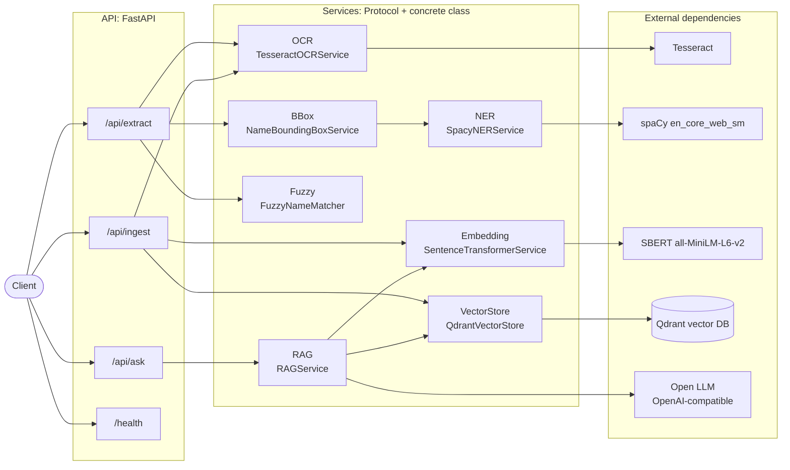
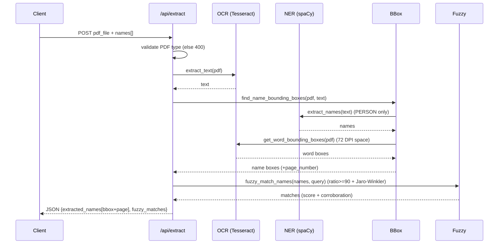
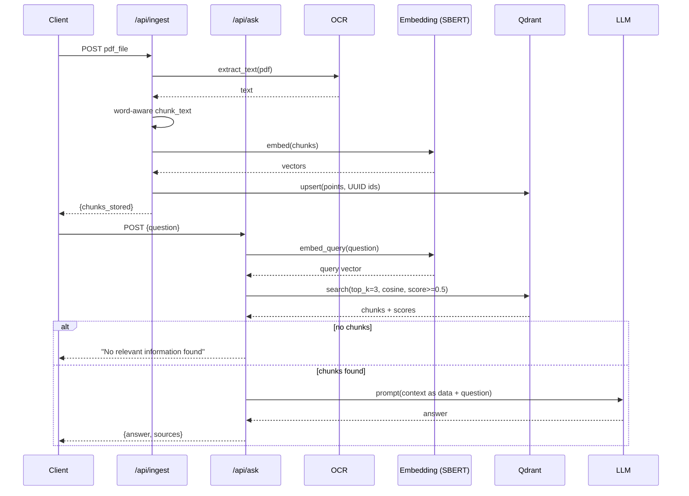

# DESIGN: PDF Name Extractor & RAG API

A FastAPI service that OCRs scanned PDFs, extracts person names with their bounding
boxes, fuzzy-matches them against a supplied list, and answers questions over the
ingested documents via RAG. Services are decoupled behind `Protocol` interfaces with
constructor dependency injection; heavy models are built once in a composition root
(`app/dependencies.py`) and configured through the environment (`app/config.py`).

## a. Component diagram

## b. Sequence diagrams

**Endpoint 1: PDF upload, name extraction, fuzzy matching**

**Endpoint 2: RAG question answering** (ingest primes the store; ask serves queries)

## c. Technology choices

| Layer | Choice | Why |
|-------|--------|-----|
| OCR | **Tesseract** (pytesseract) + **PyMuPDF** raster | Mature, open-source, no per-page cost; PyMuPDF gives fast, high-DPI rasterization and page geometry so OCR boxes can be mapped back to PDF space. |
| NER | **spaCy `en_core_web_sm`** (PERSON) | Deterministic, local, cheap, reproducible, and (unlike an instruction-following LLM) it **cannot be hijacked by injected text** hidden in a scanned document. Injection-safety at the extraction step outweighs the marginal recall gain of an LLM here. |
| Fuzzy | **thefuzz ratio (>=90)** + **Jaro-Winkler** | Name matching is lexical/typographic (OCR noise, spelling variants), not semantic; edit distance maps cleanly to the mandated 90% threshold. Jaro-Winkler (prefix-weighted) corroborates and flags disagreement. |
| Embeddings | **SBERT `all-MiniLM-L6-v2`** (384-d) | Small, fast, strong general-purpose quality; keeps the loop cheap and runs fully local. Swappable via config for `bge-small` when quality matters more than latency. |
| Vector DB | **Qdrant** | Runs as its own container in Compose, exposes scores + payload filtering for **explainable** retrieval, and scales (sharding, gRPC): the production-shaped answer the brief rewards. |
| RAG LLM | **Open self-hosted model via an OpenAI-compatible API** (e.g. Llama/Mistral on vLLM or Ollama) | Keeps the stack fully open. "OpenAI-compatible" is a wire protocol (`/chat/completions`), not a vendor lock-in: open servers (vLLM, Ollama, TGI) expose the same interface, so the client code is identical. `base_url`/`model`/`key` are config, so a neutral hosted model (gpt-3.5-turbo, Gemini) can be swapped in for convenience without any code change. |

## d. Tradeoffs considered

- **Accuracy vs speed (OCR):** rasterizing at 150 DPI instead of the ~72 DPI default fixed real
  misreads (R read as P) at a modest CPU cost. Higher DPI improves accuracy with diminishing returns and
  linear time growth.
- **Accuracy vs safety (NER):** an LLM extractor would raise recall on noisy/international names
  but opens a prompt-injection surface and adds cost/latency/non-determinism. We chose deterministic
  spaCy and confined the LLM to the answer step. (A documented cascade of LLM extraction, then
  validation, then a spaCy fallback is the
  quality-first alternative.)
- **Cost vs quality (embeddings/LLM):** MiniLM + a small open chat model are the cheap/fast, fully
  open baseline; both are one config change away from higher quality (bge/large embeddings, a larger
  open model, or a neutral hosted model like gpt-3.5-turbo / Gemini).
- **Simplicity vs robustness (chunking):** word-aware chunking that reconstructs the exact source
  text, over naive character slicing that split words mid-token.

## e. Scaling to 1000+ PDFs/hour

1000 PDFs/hour ≈ one every 3.6 s; OCR is the bottleneck (CPU-bound, seconds per page).
- **Decouple ingestion from the API:** upload drops the PDF in object storage and enqueues a job
  (SQS/Redis/Celery); a pool of **stateless OCR/embedding workers** consumes the queue and
  scales horizontally (Kubernetes HPA on queue depth). The API stays responsive.
- **Batch + cache:** batch page rasterization and embedding; cache by document hash to skip
  re-processing duplicates.
- **Qdrant:** run clustered with sharding/replication; upsert in batches; use payload indexes for
  document-scoped queries.
- **Models:** load once per worker (already the pattern here); optionally a GPU embedding tier and
  a shared model server for the LLM. Autoscale workers on backlog, not request rate.

## f. Failure modes and mitigations

| Failure | Mitigation |
|---------|------------|
| Corrupt/encrypted/non-PDF upload | Type check returns 400 (implemented); wrap OCR in try/except and fail the job cleanly, not the worker. |
| OCR misreads / empty text | Higher DPI (done); optional preprocessing (deskew/denoise); return partial results with a confidence signal. |
| Qdrant unavailable | Retries with backoff + circuit breaker; health checks; queued ingests drain when it recovers. |
| LLM error / rate limit / missing key | Timeout + error handling already wraps the call; retry with jitter; degrade to returning retrieved sources without a generated answer. |
| Prompt injection via document text | Deterministic NER (immune); in RAG the retrieved text is inserted as data with an instruction to answer only from context. |
| Duplicate/overwritten vectors | UUID point IDs (fixed) so a second document never overwrites the first. |
| Poor retrieval (low similarity) | `score_threshold` filter + "no relevant information" fallback instead of hallucinating. |

## g. LLM routing (if added)

Route by estimated query complexity to balance cost and quality:
- **Classify** each question cheaply (heuristics like length, multi-hop or comparative
  keywords, and retrieved-context size, or a tiny classifier) into `simple | moderate | complex`.
- **Map to a tier:** a simple query goes to a small, cheap local model (for example an 8B via
  vLLM/Ollama); a moderate one to gpt-3.5-turbo; a complex or low-confidence retrieval to a frontier model.
- **Implement** behind the existing `AnswerGenerator` interface as a `RoutingRAGService` that owns a
  registry of model clients and picks one per request; model tiers stay config-driven, so routing
  adds no coupling. Add a confidence-based **escalation**: if the cheap tier returns low
  self-reported confidence or fails validation, retry once on the next tier.
- **Observe:** log chosen tier, latency, token cost, and answer quality signals to tune thresholds.

## h. Production extras (beyond the assessment)

Two pieces go past what the assessment strictly requires, but in a real deployment I consider
them essential. Both are opt-in, so they never burden the core service:

- **Observability.** The app writes one structured JSON log line per request (id, timing, counts)
  to stdout, which is the 12-factor substance. An opt-in `--profile observability` Compose profile
  ships those logs to Grafana Loki and views them in Grafana. You cannot operate a document
  pipeline blind: per-request tracing, error rates, and latency are what let you debug and meet an
  SLA. Kept behind a profile so the default `docker compose up` stays app plus Qdrant only.
- **Model evaluation.** `eval/` measures RAG quality (hit-rate@k, MRR, answer accuracy) and compares
  candidate open models, logging each run to local MLflow files. The model choice (qwen2.5:3b) came
  from those numbers, not from taste. In production, every model or prompt change must be judged
  against a measured baseline, and this is that baseline. MLflow is an eval-only dependency, not part
  of the application image.
