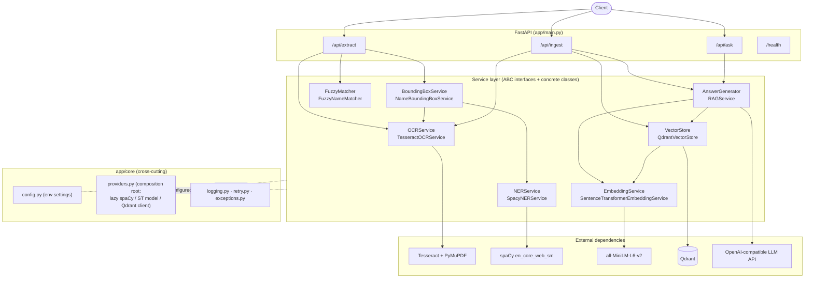
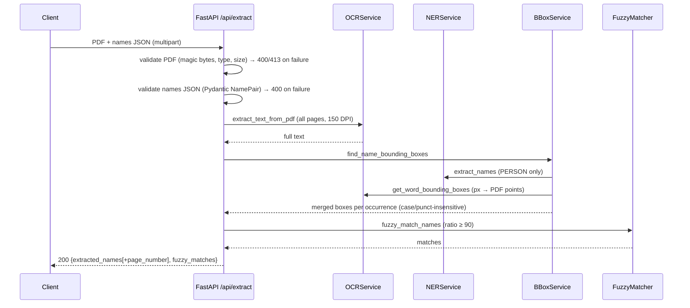
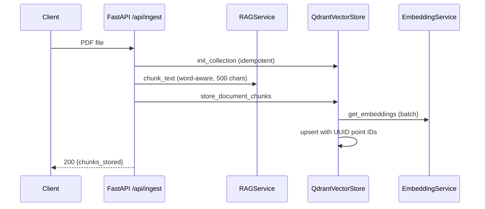
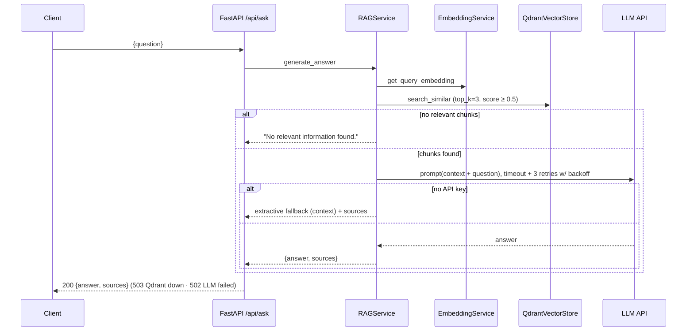

# DESIGN — PDF Name Extractor & RAG API

## 1. Component diagram

## 2. Sequence diagrams

### 2.1 PDF Extraction & Fuzzy Matching (`POST /api/extract`)

### 2.2 Document Ingestion (`POST /api/ingest`)

### 2.3 Question Answering (`POST /api/ask`)

## 3. Technology choices & tradeoffs

| Area | Choice | Justification | Tradeoff |
|---|---|---|---|
| OCR | Tesseract (pytesseract) + PyMuPDF rendering at 150 DPI | Open-source, mature, word-level boxes + confidences, no GPU needed | Lower accuracy than cloud OCR/PaddleOCR on noisy scans; 150 DPI balances accuracy vs speed (300 DPI ≈ 4× pixels) |
| NER | spaCy `en_core_web_sm` | Fast (ms per doc), CPU-only, deterministic, easy to ship in a container | Lower recall than transformer NER or LLM zero-shot; interface (`NERService`) allows swapping in `en_core_web_trf` or an LLM extractor without touching callers |
| Fuzzy | `thefuzz` `ratio` @ 90 | Full-string Levenshtein resists substring inflation (`partial_ratio` scored "Jo Sm" ≈ 100 vs "John Smith"); tolerates 1–2 OCR typos | Very corrupted OCR names fall below 90; threshold is configurable per deployment |
| Embeddings | `all-MiniLM-L6-v2` (384-d) | Excellent quality/speed ratio on CPU, tiny footprint, well-supported | Weaker than large embedding models on long/nuanced text; swap via `EmbeddingService` + one config value |
| Vector DB | Qdrant | Production-grade, simple Docker deployment, payload filtering, HNSW, horizontal scaling | Heavier than Chroma for tiny workloads; chosen for the growth path |
| LLM | OpenAI-compatible HTTP API (model configurable) | No SDK lock-in — any compatible gateway (OpenAI, Azure, vLLM, Ollama) works by changing `OPENAI_BASE_URL` | Network dependency; mitigated with timeout, retries, and extractive fallback when no key is configured |

**Accuracy vs speed:** 150 DPI OCR + MiniLM + small spaCy model favor throughput on CPU; every piece is swappable behind an interface when accuracy becomes the priority. **Cost vs quality:** the default LLM is a cheap model; routing (§6) upgrades only complex queries.

**Model profiles (multi-language):** clients pick a friendly tier — `english_fast` (default), `spanish_precision`, `multilingual` — via an optional `profile` parameter (`GET /api/profiles` lists them). Server-side, each profile maps to an OCR language, spaCy model, embedding model, and a **dedicated Qdrant collection**, since embeddings from different models live in incompatible vector spaces. Internal model names never leak into the API, so models can be upgraded without breaking clients.

## 4. Scaling to 1000+ PDFs/hour

1000 PDFs/h ≈ one every 3.6 s; OCR of a multi-page PDF is the bottleneck (seconds per page, CPU-bound).

- **Decouple ingestion**: `/api/ingest` and `/api/extract` become "accept + enqueue" (S3/MinIO for files, Redis/RabbitMQ/SQS for jobs) returning `202 + job_id`; workers do OCR→NER→embed→upsert. The API stays responsive regardless of load.
- **Horizontal workers**: OCR workers are stateless → scale with queue depth (KEDA/HPA). ~10–20 workers sustain 1000 PDFs/h for typical 2–5 page docs; pages of one PDF can also be OCR'd in parallel.
- **Batch embeddings**: encode chunks in batches (already batched per document); optionally a dedicated embedding service (e.g., TEI) with GPU if volume grows 10×.
- **Qdrant**: single node handles millions of vectors; then sharding/replicas via Qdrant distributed mode. Use per-tenant payload filters or collections.
- **Caching**: hash the PDF (SHA-256) to skip re-processing duplicates; cache frequent RAG answers.
- **Observability**: queue depth, OCR seconds/page, p95 latency per endpoint, Qdrant errors — with alerts before saturation.

## 5. Failure modes & mitigations

| Failure | Impact | Mitigation (implemented ✔ / roadmap →) |
|---|---|---|
| Non-PDF or corrupt upload | Worker crash / garbage output | ✔ magic-bytes + content-type + size validation → 400/413 |
| Qdrant down | Ingest/ask fail | ✔ wrapped in `VectorStoreError` → 503 with clear message; → circuit breaker + queue retry |
| LLM API down/slow | /ask hangs or 500s | ✔ timeout + 3 retries with exponential backoff → 502; ✔ extractive fallback when unconfigured; → secondary provider failover |
| OCR garbage on low-quality scans | Names missed | ✔ confidence filter hook + fuzzy threshold; → preprocessing (deskew/binarize), 300 DPI re-run on low-confidence pages |
| Duplicate ingestion overwrites data | Silent data loss | ✔ UUID point IDs (bug fixed); → content-hash dedup |
| Model files missing at runtime | Cold-start crash | ✔ models baked into the image at build time |
| Memory growth (model per request) | OOM | ✔ models loaded once via cached providers |
| Crash mid-request leaves temp files | Disk fill | ✔ try/finally cleanup of temp files; ✔ documents closed |

## 6. LLM routing strategy

Add a `ModelRouter` in front of `RAGService._call_llm` implementing the same `AnswerGenerator` contract:

1. **Classify complexity** cheaply per query: heuristics first (length, multi-hop connectives like "compare/why/derive", retrieval score dispersion, count of retrieved chunks needed), optionally a tiny classifier or a 1-token LLM self-assessment. Score → `simple | standard | complex`.
2. **Route by tier**: `simple` → small/cheap model (or purely extractive answer when retrieval confidence is very high); `standard` → default mid-tier model; `complex` → frontier model with larger context and more retrieved chunks (top_k 8–10 + reranking).
3. **Guardrails**: per-tier token/cost budgets, escalation on low answer confidence ("I don't have enough information" from the small model triggers one retry on the tier above), and per-tenant rate limits.
4. **Operability**: the tier map lives in configuration (env/file) so models can be swapped without deploys; log `(query, tier, cost, latency, feedback)` to retrain the classifier and tune thresholds.

This keeps ~80% of traffic on cheap models while preserving quality where it matters — the routing decision is data, not code.
