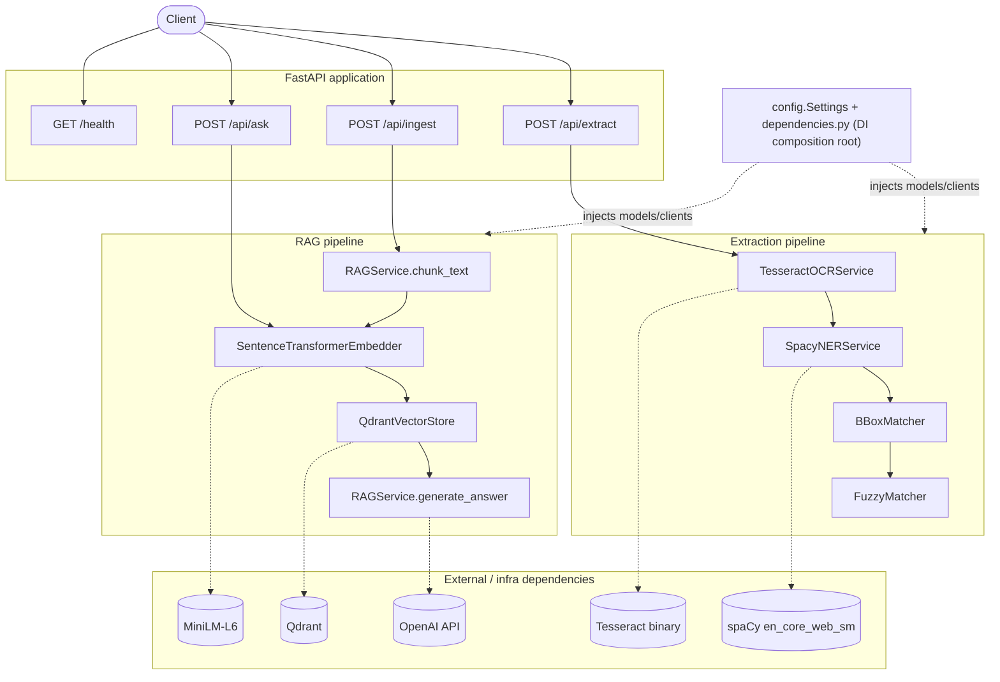
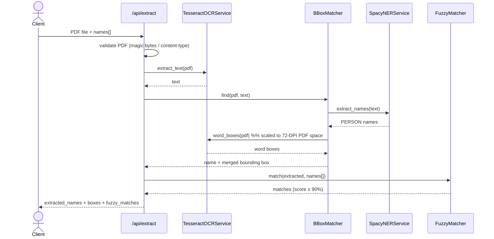
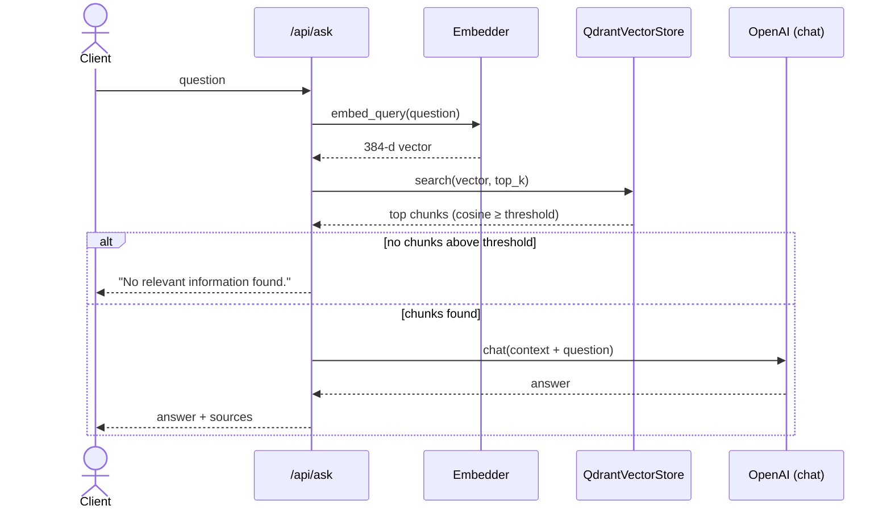

# Design — PDF Name Extractor & RAG API

A FastAPI service that (1) extracts person names + bounding boxes from scanned
PDFs and fuzzy-matches them against a query, and (2) answers questions over
ingested PDFs with a Retrieval-Augmented Generation pipeline.

## 1. Component diagram

## 2. Sequence diagrams

### 2a. `POST /api/extract` — extraction + fuzzy matching

### 2b. `POST /api/ask` — RAG question answering

> Ingestion (`POST /api/ingest`) is the write path that feeds 2b: it OCRs the
> PDF, `chunk_text`s it word-safely, embeds each chunk and upserts it into
> Qdrant with a unique UUID id.

## 3. Technology choices & justification

| Concern | Choice | Why |
|---|---|---|
| OCR | **Tesseract** (via `pytesseract`) + **PyMuPDF** rasterisation | Mature, free, on-device (no per-page cloud cost or PII egress). PyMuPDF gives fast, high-DPI page rendering. Hidden behind `OCREngine` so it can be swapped for EasyOCR/PaddleOCR/cloud OCR. |
| NER | **spaCy `en_core_web_sm`** | Tiny (~12 MB), fast, deterministic, runs in-process with no API cost — ideal for the narrow "person names" task. The `NERModel` interface allows upgrading to a transformer model or zero-shot LLM NER without touching callers. |
| Embeddings | **sentence-transformers `all-MiniLM-L6-v2`** | 384-d, strong quality-for-size, CPU-friendly, free and local. Loaded once and cached. |
| Vector DB | **Qdrant** | Open-source, Docker-native, cosine similarity + payload filtering, simple client. `VectorStore` interface keeps Chroma/pgvector swappable. |
| LLM | **OpenAI-compatible chat** (configurable base URL/model) | Highest answer quality; the OpenAI-compatible contract also targets Azure/Together/Ollama by changing one env var. |
| Config/DI | **pydantic-settings** + a factory composition root | Twelve-factor config, typed, and a single place where heavy models are built and injected. |

## 4. Tradeoffs considered

- **Accuracy vs speed (OCR):** rasterising at 150 DPI rather than the default 72
  DPI roughly quadruples pixels per page (slower) but is what makes names
  legible — at 72 DPI Tesseract misread "Richard" as "Pichard". DPI is a config knob.
- **Local vs cloud models:** spaCy small + MiniLM trade a few points of accuracy
  for zero marginal cost, no network dependency, and no PII leaving the host.
- **Fuzzy scorer:** `fuzz.ratio` (full-string) over `partial_ratio` — partial
  matching inflated scores so substrings passed; full ratio keeps the 90% bar
  meaningful while tolerating OCR typos.
- **Bounding-box matching:** names are matched to the first OCR occurrence of
  each word part (simple, fast). Known limitation: when the same word appears in
  several places the merged box can be over-large; a future improvement is
  proximity-aware grouping (match adjacent word boxes).
- **Synchronous request path:** simplest correct design; for throughput the
  heavy work should move to a queue (see §5).

## 5. Scaling to 1000+ PDFs/hour

1000 PDFs/hour ≈ 0.28/s average, but real load is bursty and OCR is the
bottleneck (CPU-bound, ~1–5 s/page).

- **Decouple ingestion from the API.** `/api/ingest` enqueues a job
  (Redis/RabbitMQ/SQS) and returns `202`. A pool of **worker** processes
  (Celery/RQ/Kubernetes Jobs) does OCR → NER → embed → upsert. Scale workers
  horizontally; OCR parallelises trivially per page/document.
- **Make the API stateless** and run N replicas behind a load balancer; models
  are baked into the image so pods start fast and warm.
- **Qdrant** runs as a clustered/replicated service (or managed) with the
  collection sharded; it comfortably handles this write rate.
- **Cache & batch:** cache embeddings/answers by content hash; batch-encode
  chunks (sentence-transformers vectorises batches efficiently); consider GPU
  workers or an ONNX/quantised OCR+embedding path for throughput.
- **Backpressure & autoscaling:** scale workers on queue depth; cap concurrency
  to protect Qdrant and the LLM rate limits.

## 6. Failure modes & mitigations

| Failure | Mitigation |
|---|---|
| Corrupt / non-PDF upload | Magic-byte + content-type validation → `400`; per-request temp file always cleaned in `finally`. |
| Empty OCR (blank/handwritten scan) | Returns empty results gracefully (no crash); log + (future) low-confidence flag. |
| OCR misreads / typos | Higher DPI; fuzzy matching tolerates small errors; threshold configurable. |
| Qdrant down/unreachable | Client construction is lazy; failed calls surface as `5xx`; add retries/circuit-breaker + health-gated readiness in production. |
| LLM key missing / rate-limited / timeout | Missing key fails fast with a clear message; HTTP call has a timeout + `raise_for_status`; add retry-with-backoff and a fallback model. |
| Duplicate ingestion overwriting data | Fixed: UUID point ids (was `id=i`). Add content-hash dedupe to avoid re-ingesting. |
| Model/asset download at runtime | Baked into the Docker image so containers boot offline. |
| Large PDFs exhausting memory | Stream page-by-page (already per-page); enforce size/page limits at the edge. |

## 7. If I added LLM routing (model selection by query complexity)

Introduce an `LLMClient` strategy (already declared as a Protocol) behind a
**router** that scores each query and dispatches to a tier:

1. **Signals:** token length, retrieved-context size, question type
   (factoid vs multi-hop/reasoning), required tools, and a cheap **classifier**
   (heuristics or a small model) returning `simple | standard | complex`.
2. **Policy → model tier:** `simple → small/cheap` (e.g. gpt-4o-mini / local),
   `standard → mid`, `complex → large`. Config-driven mapping so tiers are
   tunable without code changes.
3. **Guardrails:** per-tier cost/latency budgets; **escalate** on low confidence
   or refusal (retry one tier up); **cache** by (query, context) hash.
4. **Observability:** log chosen tier, tokens, latency, cost, and a sampled
   quality signal to continuously re-tune the routing thresholds.

This isolates routing in one component; the endpoints keep calling
`llm.complete(prompt)` and are unaware of which model served the request.
